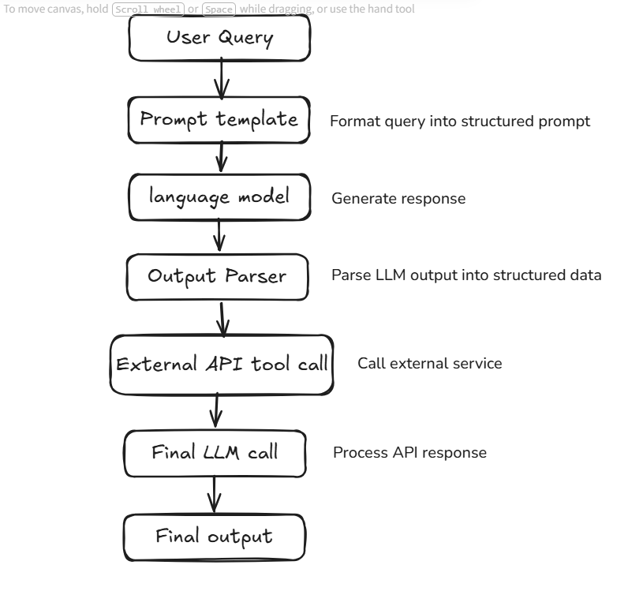

# Project 02 – LangChain Chain

A simple LangChain chain that takes some information about a person and uses a local LLM (Ollama) to generate a short summary and two interesting facts.

## How a Chain Works



A chain connects steps so the output of one becomes the input of the next. This project uses the first part of the flow:

```
PromptTemplate  →  ChatOllama (gemma3:4b)  →  Output
```

## Setup

1. Install [Ollama](https://ollama.com) and pull the model:
   ```bash
   ollama pull gemma3:4b
   ```
2. Install dependencies with [uv](https://docs.astral.sh/uv/):
   ```bash
   uv sync
   ```

## Run

```bash
uv run main.py
```
